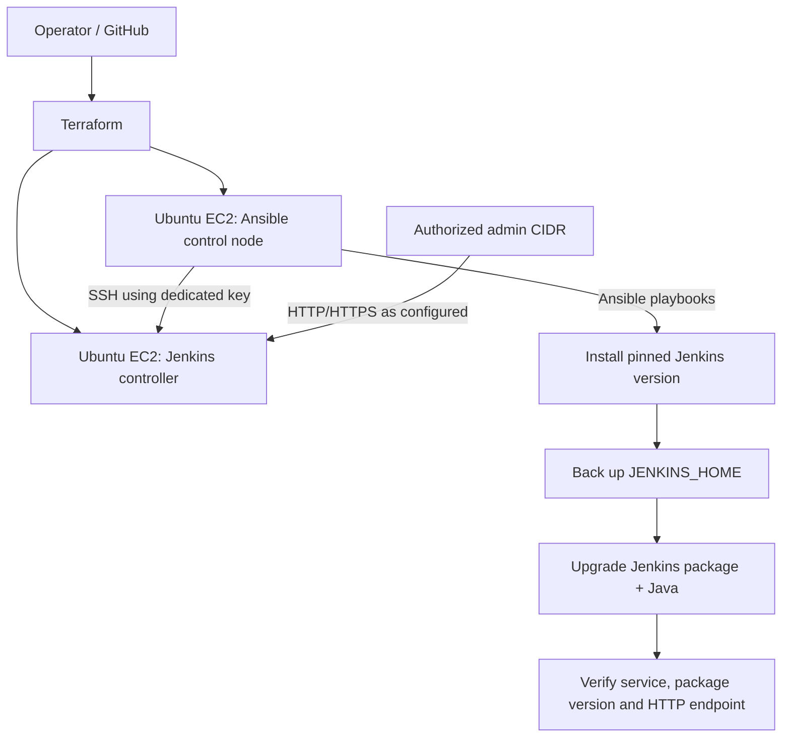

# Jenkins Upgrade Automation on AWS

**Terraform · AWS EC2 · Ansible · Jenkins · Java · GitHub Actions**

A reproducible infrastructure and configuration-management project that provisions an Ansible control node and a Jenkins target on AWS, installs a specified Jenkins package version, backs up Jenkins home before maintenance, upgrades Jenkins through Ansible, and verifies the resulting service.

> **Important:** The source PDF demonstrates Jenkins `2.249.1` as the baseline and shows a later browser screenshot reporting `2.490`. Jenkins `2.249.1` is old and should be used only in an isolated lab to demonstrate version pinning. Do not expose an old Jenkins controller to the public internet. The upgrade playbook resolves the current package version from the configured Jenkins stable repository at execution time; it does not hard-code a future version.

## What this demonstrates

- Terraform provisioning for two Ubuntu EC2 instances and scoped security groups.
- Ansible inventory generated from Terraform outputs rather than copied public IPs.
- Jenkins package installation at an explicitly requested version.
- Pre-upgrade backup of `/var/lib/jenkins` and a recorded backup path.
- Package upgrade through Ansible's `apt` module, Java runtime alignment, and service verification.
- Validation commands and evidence screenshots sourced from the supplied project PDF.
- GitHub Actions checks for Terraform formatting/validation and Ansible syntax.

## Architecture



The Ansible node is the control machine. Terraform creates both instances and emits an inventory file under `ansible/inventory/terraform.ini`. The Jenkins controller's web port is only allowed from `admin_cidr`; SSH is limited to `admin_cidr` and the control node security group.

## Repository layout

```text
.
├── index.html
├── terraform/
│   ├── main.tf
│   ├── variables.tf
│   ├── outputs.tf
│   ├── versions.tf
│   ├── terraform.tfvars.example
│   └── modules/ec2/
├── ansible/
│   ├── ansible.cfg
│   ├── inventory/example.ini
│   ├── playbooks/site.yml
│   ├── playbooks/install-pinned.yml
│   ├── playbooks/backup.yml
│   ├── playbooks/upgrade.yml
│   ├── playbooks/verify.yml
│   └── roles/
├── docs/
│   ├── architecture.md
│   ├── runbook.md
│   ├── patching-explained.md
│   └── screenshots/
├── scripts/
├── .github/workflows/validate.yml
├── LICENSE
├── CHANGELOG.md
├── CONTRIBUTING.md
└── .gitignore
```

## Prerequisites

- AWS account with permission to create EC2 instances, security groups, key pairs and related resources.
- Terraform 1.5+ and AWS CLI on the operator machine.
- A dedicated SSH key pair. Do not commit private keys.
- A valid public IPv4 CIDR for `admin_cidr`, e.g. `203.0.113.10/32` (replace this documentation-only address with your own IP).
- Review AWS costs before applying. EC2, EBS volumes, snapshots and public IPv4 addresses may incur charges.

## Quick start

### 1. Configure Terraform

```bash
cd terraform
cp terraform.tfvars.example terraform.tfvars
# Edit terraform.tfvars: set admin_cidr and public_key_path.
terraform init
terraform fmt -check -recursive
terraform validate
terraform plan
terraform apply
```

Terraform provisions Ubuntu LTS instances and creates an inventory from its outputs. Private key material remains on your workstation/control node and is never generated by Terraform.

### 2. Prepare Ansible access

Copy your private key securely to the Ansible control node (or run Ansible from a trusted machine), then set `ansible_private_key_file` in `ansible/ansible.cfg` or pass `--private-key`. Ensure the key is readable only by its owner (`chmod 600` on Linux). Do not use a key stored in the repository.

The generated inventory is written to `ansible/inventory/terraform.ini`. If running Ansible locally, use the same inventory output but configure the SSH user and key path for your environment.

### 3. Install a specific Jenkins version

```bash
cd ../ansible
ansible-inventory -i inventory/terraform.ini --list
ansible-playbook -i inventory/terraform.ini playbooks/install-pinned.yml   -e jenkins_version=2.249.1
```

**Compatibility note:** Old Jenkins versions may not work with current Java, plugins, or repository metadata. The pinned version is included to mirror the source PDF's exercise. Use a disposable isolated lab, and prefer a supported Jenkins LTS version for real workloads.

### 4. Back up, upgrade, and verify

```bash
ansible-playbook -i inventory/terraform.ini playbooks/backup.yml
ansible-playbook -i inventory/terraform.ini playbooks/upgrade.yml
ansible-playbook -i inventory/terraform.ini playbooks/verify.yml
```

The backup role creates a timestamped archive of Jenkins home and stores it under `/var/backups/jenkins`. A filesystem archive is useful for a lab, but a production backup plan should also include consistent snapshots, off-host storage, retention, restore tests, and plugin/version compatibility checks.

### 5. Destroy lab resources

```bash
cd ../terraform
terraform destroy
```

Destroying the EC2 instances does not necessarily delete separately retained backups or snapshots. Review AWS resources and charges after teardown.

## Patching terminology

This project applies a **binary/package patch**: Ansible's `apt` module updates the installed Jenkins package from the configured package repository. It does not patch Jenkins source code. See [`docs/patching-explained.md`](docs/patching-explained.md).

## Evidence screenshots

The screenshots in `docs/screenshots/` are extracted from the supplied eight-page PDF. They document the original lab's Terraform provisioning, successful Ansible tasks, backup approach and Jenkins version screens. They are historical evidence, not proof that this newly organized repository has been run end-to-end in a fresh AWS account.

## Security and operational notes

- Do not expose Jenkins directly to `0.0.0.0/0`; restrict access to a trusted CIDR or use a VPN/bastion/reverse proxy.
- The source lab used public IPs and an older Jenkins version. This repository narrows inbound rules, but it is still a learning/lab design, not a complete high-availability production architecture.
- Keep AWS credentials out of source control. Prefer IAM roles and short-lived credentials.
- Back up before upgrades and test restoration before relying on a backup.
- Review plugin compatibility, Java requirements, release notes and upgrade guides before production changes.

## Resume-ready project summary

Automated Jenkins version management on AWS using Terraform and Ansible. Provisioned separate control and target EC2 instances, configured SSH-based inventory, installed a pinned Jenkins package version, created a pre-upgrade Jenkins home backup, and automated package upgrades and post-upgrade service checks. Added infrastructure validation, repeatable runbooks, security-group restrictions and documented evidence for the maintenance workflow.

## Validation status

Repository files and screenshot assets are generated from the supplied PDF and reviewed structurally. This environment has not applied Terraform to AWS or executed the playbooks against a live Jenkins host. Validate the exact AMI, package availability, Java compatibility, security rules and restore procedure in a disposable account before using the project as a live demo.

## License

MIT. See [`LICENSE`](LICENSE).
